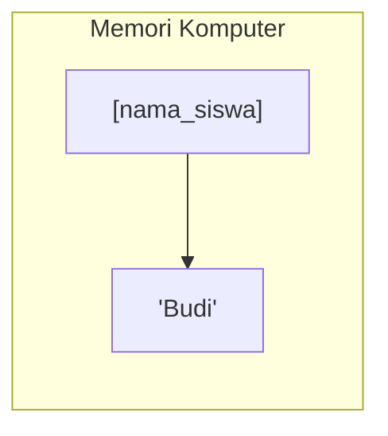

# 🐍 Pemrograman Python Dasar
## Pertemuan 01: Pengenalan Python & Variabel

Mengenal Sejarah, Ekosistem, Instalasi, hingga Memulai dengan Variabel

<div class="pt-8">
  <span class="px-4 py-1.5 rounded-full bg-emerald-500/20 text-emerald-300 text-sm border border-emerald-500/40">
    Pertemuan 01 • Fundamental Kelas Pemrograman
  </span>
</div>

<div class="abs-bottom-12 text-sm text-gray-400">
  Target: Peserta mengenal sejarah, manfaat, instalasi, serta mampu mendeklarasikan & menginisialisasikan variabel
</div>

---
layout: default
---

# 🎯 Target Pencapaian & Agenda Hari Ini

Berdasarkan silabus pembelajaran pertemuan 1:

<div class="grid grid-cols-2 gap-6 mt-6">
<div class="p-4 rounded-xl bg-emerald-500/10 border border-emerald-500/30">
  <h3 class="text-emerald-400 font-bold mb-2">🎯 Target Pencapaian</h3>
  <ul class="space-y-2 text-sm">
    <li>✅ Peserta mengenal sejarah & manfaat bahasa Python.</li>
    <li>✅ Peserta memahami kelebihan & kekurangan Python.</li>
    <li>✅ Peserta mampu melakukan instalasi dan setup tools.</li>
    <li>✅ Peserta mampu mendeklarasikan dan menginisialisasikan variabel secara tepat.</li>
  </ul>
</div>

<div class="p-4 rounded-xl bg-cyan-500/10 border border-cyan-500/30">
  <h3 class="text-cyan-400 font-bold mb-2">📋 Rincian Materi</h3>
  <ul class="space-y-2 text-sm">
    <li>1. Sejarah & Filosofi Python</li>
    <li>2. Kelebihan & Kekurangan Python</li>
    <li>3. Manfaat & Penerapan di Industri</li>
    <li>4. Panduan Instalasi (Windows/Mac/Linux)</li>
    <li>5. Menjalankan Kode Pertama (REPL vs Script)</li>
    <li>6. Deklarasi & Inisialisasi Variabel</li>
  </ul>
</div>
</div>

---
layout: two-cols
---

# 📜 Sejarah Singkat Python

::left::
### Siapa Pembuatnya?
- Diciptakan oleh **Guido van Rossum** di Centrum Wiskunde & Informatica (CWI), Belanda.
- Mulai dirilis pertama kali pada tahun **1991**.
- Namanya **bukan** berasal dari ular piton, melainkan dari acara komedi BBC favorit Guido: *"Monty Python's Flying Circus"*.

> *"Readability counts."*  
> — Filosofi The Zen of Python

::right::
### Filosofi Desain (The Zen of Python)
Python dirancang dengan prinsip:
1. **Indah lebih baik daripada buruk** (*Beautiful is better than ugly*).
2. **Eksplisit lebih baik daripada implisit** (*Explicit is better than implicit*).
3. **Sederhana lebih baik daripada rumit** (*Simple is better than complex*).
4. **Keterbacaan kode adalah yang utama** (*Readability counts*).

Bisa dilihat di terminal dengan perintah:
```python
import this
```

---
layout: two-cols
---

# ⚖️ Kelebihan & Kekurangan Python

::left::
### 🌟 Kelebihan (Pros)
- **Mudah Dipelajari & Dibaca**: Sintaks sangat mirip bahasa Inggris natural.
- **Produktivitas Tinggi**: Menyelesaikan tugas dengan baris kode jauh lebih sedikit dibanding C++ atau Java.
- **Standard Library Lengkap**: Konsep *"Batteries Included"* — modul bawaan sudah melimpah.
- **Komunitas Raksasa & Multi-platform**: Berjalan di Windows, macOS, Linux, dan Cloud.

::right::
### ⚠️ Kekurangan (Cons)
- **Kecepatan Eksekusi**: Karena bahasa *interpreted*, kecepatan komputasinya lebih lambat dibanding bahasa kompilasi seperti C/C++/Rust.
- **Konsumsi Memori**: Penggunaan RAM relatif lebih tinggi.
- **Bukan Pilihan Utama Mobile**: Kurang umum digunakan untuk pengembangan aplikasi native Android/iOS langsung.

---
layout: default
---

# 🌐 Manfaat & Penerapan Python di Industri

Mengapa Python menjadi bahasa pemrograman paling populer di dunia saat ini?

<div class="grid grid-cols-4 gap-4 mt-6">
  <div class="p-4 rounded-lg bg-blue-500/10 border border-blue-500/20 text-center">
    <div class="text-3xl mb-2">🤖</div>
    <div class="font-bold text-sm">Data Science & AI</div>
    <div class="text-xs text-gray-400 mt-1">Pandas, NumPy, TensorFlow, PyTorch</div>
  </div>
  <div class="p-4 rounded-lg bg-green-500/10 border border-green-500/20 text-center">
    <div class="text-3xl mb-2">🌐</div>
    <div class="font-bold text-sm">Web Development</div>
    <div class="text-xs text-gray-400 mt-1">Django, FastAPI, Flask</div>
  </div>
  <div class="p-4 rounded-lg bg-amber-500/10 border border-amber-500/20 text-center">
    <div class="text-3xl mb-2">⚙️</div>
    <div class="font-bold text-sm">Automation & Scripting</div>
    <div class="text-xs text-gray-400 mt-1">Web scraping, bot otomasi, DevOps</div>
  </div>
  <div class="p-4 rounded-lg bg-purple-500/10 border border-purple-500/20 text-center">
    <div class="text-3xl mb-2">🛡️</div>
    <div class="font-bold text-sm">Cybersecurity & IoT</div>
    <div class="text-xs text-gray-400 mt-1">Penetration testing, Raspberry Pi</div>
  </div>
</div>

---
layout: two-cols
---

# 💻 Langkah Instalasi Python

::left::
### 1. Unduh Installer Resmi
Kunjungi website resmi: [python.org/downloads](https://www.python.org/downloads/)

### 2. Centang Opsi PATH (Penting!)
Saat membuka installer di Windows:
> ⚠️ **Wajib Centang**:  
> `☑ Add python.exe to PATH`  
> Jika terlewat, terminal tidak akan mengenali perintah `python`.

::right::
### 3. Verifikasi Instalasi
Buka Terminal / Command Prompt / PowerShell, lalu ketik:

```bash
python --version
```
Output yang diharapkan:
```
Python 3.x.x
```

### 4. Code Editor yang Digunakan
- **VS Code (Visual Studio Code)** (Rekomendasi)
- Pasang ekstensi **Python** resmi dari Microsoft di VS Code.

---
layout: two-cols
---

# 🚀 2 Cara Menjalankan Kode Python

::left::
### Mode Interaktif (REPL)
Langsung eksekusi per baris di terminal. Sangat bagus untuk mencoba hal cepat.

```bash
$ python
>>> 2 + 5
7
>>> print("Halo!")
Halo!
>>> exit()
```

Ketik `exit()` untuk keluar dari mode REPL.

::right::
### Mode Script File (`.py`)
Menulis kode lengkap ke dalam file, lalu menjalankannya sekaligus.

1. Buat file baru bernama `main.py`
2. Tuliskan instruksi kode:
```python
print("Halo dari file script!")
```
3. Eksekusi melalui terminal:
```bash
python main.py
```

---
layout: default
---

# ✍️ Kode Pertama & Komentar

Di Python, fungsi `print()` digunakan untuk menampilkan keluaran ke konsol, dan tanda pagar `#` digunakan untuk menulis komentar penjelas.

```python
# Ini adalah komentar 1 baris (diabaikan oleh komputer)
print("Selamat datang di Kelas Python Dasar!")

# Anda bisa mencetak beberapa data sekaligus dipisahkan koma
print("Nama:", "Ahmad", "Kelas:", 1)

"""
Ini adalah komentar multi-baris (Docstring).
Biasa digunakan untuk catatan panjang atau dokumentasi fungsi.
"""
print("Python sangat mudah dan menyenangkan!")
```

<div class="mt-4 p-3 rounded bg-emerald-500/10 border border-emerald-500/30 text-sm">
💡 <b>Komentar</b> sangat penting agar kode yang kita tulis mudah dipahami oleh diri sendiri di masa depan maupun oleh rekan tim.
</div>

---
layout: two-cols
---

# 📦 Apa itu Variabel?

::left::
### Analogi Kotak Penyimpanan
Bayangkan **variabel** seperti sebuah kotak berpapan nama di dalam memori komputer:
- **Nama Variabel**: Label pada kotak (misal: `nama_siswa`)
- **Nilai (Value)**: Benda yang dimasukkan ke kotak (misal: `"Budi"`)



::right::
### Deklarasi & Inisialisasi
Di Python, variabel langsung dibuat saat pertama kali diberi nilai (**menggunakan tanda sama dengan `=`**):

```python
# Inisialisasi variabel
nama = "Budi Santoso"
usia = 20
tinggi_badan = 175.5
is_aktif = True

# Menampilkan isi variabel
print(nama)
print(usia)
```

---
layout: two-cols
---

# 🏷️ Aturan Penamaan Variabel (PEP 8)

::left::
### ✅ Boleh & Dianjurkan
- Menggunakan huruf kecil dan underscore (**snake_case**):  
  `nama_lengkap`, `total_harga`, `status_aktif`
- Diawali huruf atau garis bawah:  
  `skor`, `_token`
- Angka boleh digunakan di tengah atau akhir:  
  `user1`, `item_2`
- Bersifat **Case Sensitive**:  
  `Nama` $\neq$ `nama` $\neq$ `NAMA`

::right::
### ❌ Tidak Boleh (Akan Error)
- Diawali dengan angka:  
  `1nama = "Budi"` ❌ *(SyntaxError)*
- Mengandung spasi:  
  `nama siswa = "Budi"` ❌
- Mengandung simbol khusus (`-`, `!`, `@`, `$`, `%`):  
  `nama-siswa = "Budi"` ❌
- Menggunakan kata kunci bawaan (*Reserved Keywords*):  
  `if`, `for`, `class`, `def`, `while`, `True` ❌

---
layout: default
---

# 🗂️ 4 Tipe Data Dasar untuk Variabel

Saat menginisialisasi variabel, Python secara otomatis mendeteksi tipe datanya (*Dynamic Typing*):

| Tipe Data | Kata Kunci | Contoh Nilai | Keterangan |
|---|---|---|---|
| **String** | `str` | `"Halo"`, `'Python 101'` | Teks yang diapit tanda petik satu/dua |
| **Integer** | `int` | `10`, `0`, `-25`, `2026` | Bilangan bulat tanpa desimal |
| **Float** | `float` | `3.14`, `175.5`, `-0.75` | Bilangan pecahan / desimal |
| **Boolean** | `bool` | `True`, `False` | Nilai kebenaran (huruf awal wajib kapital) |

### Mengecek Tipe Data dengan `type()`
```python
x = 100
teks = "Belajar Python"
print(type(x))     # <class 'int'>
print(type(teks))  # <class 'str'>
```

---
layout: two-cols
---

# 🔄 Mengubah Isi Variabel (Re-assignment)

::left::
Nilai di dalam variabel bersifat dinamis dan dapat diubah sewaktu-waktu:

```python
# Nilai awal
skor = 10
print("Skor awal:", skor)

# Diperbarui / diubah nilainya
skor = 25
print("Skor baru :", skor)

# Bahkan bisa berganti tipe data
skor = "Seratus"
print("Skor teks :", skor)
```

::right::
### Inisialisasi Banyak Variabel Sekaligus
Python memungkinkan inisialisasi praktis dalam satu baris:

```python
# Multiple Assignment
a, b, c = 10, 20, 30
print(a, b, c)

# Nilai yang sama untuk banyak variabel
x = y = z = 0
print(x, y, z)
```

---
layout: default
---

# 💬 Menampilkan Variabel dengan Modern f-string

Cara terbaik dan paling rapi untuk menampilkan variabel adalah menggunakan **f-string** (format string dengan awalan `f"..."`):

```python
nama = "Siti Aisyah"
jurusan = "Teknik Informatika"
semester = 2
ipk = 3.85

# Menggabungkan teks dan variabel dengan f-string
pesan = f"Halo! Nama saya {nama}, mahasiswa {jurusan} semester {semester} dengan IPK {ipk}."
print(pesan)
```

<div class="mt-4 p-4 rounded-xl bg-blue-500/10 border border-blue-500/30 text-sm">
💡 <b>Keunggulan f-string</b>: Anda cukup meletakkan nama variabel di dalam kurung kurawal <code>{nama_variabel}</code> tanpa perlu repot melakukan konkatenasi manual tanda plus <code>+</code>.
</div>

---
layout: default
---

# 💻 Praktikum & Latihan Pertemuan 01

Silakan buka folder `pertemuan-01-pengenalan-dan-variabel/`:

1. **Folder `contoh/`**:
   - `01_halo_python.py` : Menjalankan kode print pertama & memahami komentar
   - `02_deklarasi_variabel.py` : Latihan inisialisasi, re-assignment, dan aturan penamaan
   - `03_tipe_data_dasar.py` : Mengenal tipe data int, float, str, bool & fungsi type()
   - `04_menampilkan_variabel.py` : Berbagai gaya menampilkan data (print biasa vs f-string)
   - `05_input_variabel_sederhana.py` : Menyimpan input keyboard ke dalam variabel
2. **Folder `latihan/`**:
   - `soal_latihan.md` : Studi kasus pembuatan kartu biodata diri & eksplorasi variabel
   - `latihan_mandiri.py` : Lembar kerja praktikum siswa
   - `solusi/solusi_latihan.py` : Kunci jawaban dan pembahasan

---
layout: text-center
class: my-auto
---

# 🎉 Selamat! Anda Telah Memulai Perjalanan Python
### Pada pertemuan berikutnya, kita akan membahas: **Operator dan Percabangan (`if-elif-else`)**

Ada pertanyaan seputar sejarah, instalasi, atau pembuatan variabel?
