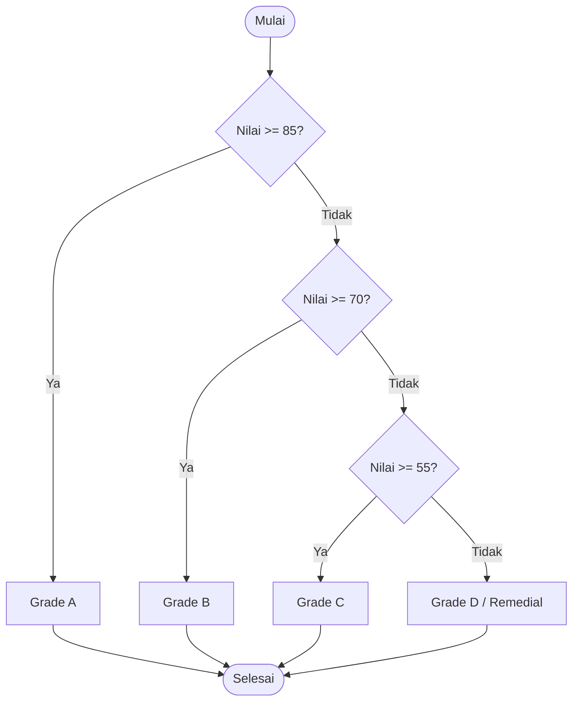

# 🐍 Pemrograman Python Dasar
## Pertemuan 02: Operator & Logika Percabangan

Mengontrol Alur Program dengan Operator dan Kondisi (`if`, `elif`, `else`)

<div class="pt-12">
  <span class="px-3 py-1.5 rounded-full bg-cyan-500/20 text-cyan-300 text-sm border border-cyan-500/40">
    Pertemuan 02 • Control Flow & Operators
  </span>
</div>

---
layout: default
---

# 🎯 Agenda Pertemuan 02

Hari ini kita akan membuat program yang mampu mengambil keputusan logis:

- **1. Operator Aritmatika**: Penjumlahan, modulus (`%`), pembagian bulat (`//`), pangkat (`**`)
- **2. Operator Perbandingan**: `==`, `!=`, `>`, `<`, `>=`, `<=`
- **3. Operator Logika**: `and`, `or`, `not`
- **4. Percabangan Dasar**: Struktur `if`, `if-else`, dan `if-elif-else`
- **5. Nested `if` (Kondisi Bersarang)** & Shorthand Ternary Operator
- **6. Studi Kasus**: Sistem Penilaian Akademik & Tiket Wahana

---
layout: two-cols
---

# ➕ Operator Aritmatika Khusus

::left::
Di Python, selain `+`, `-`, `*`, dan `/`, ada 3 operator penting:

| Operator | Nama | Contoh | Hasil |
|---|---|---|---|
| `%` | Modulus (sisa bagi) | `10 % 3` | `1` |
| `//` | Floor Division (bulat ke bawah) | `10 // 3` | `3` |
| `**` | Eksponensial (pangkat) | `2 ** 4` | `16` |

::right::
```python
# Cek bilangan genap atau ganjil dengan modulus
angka = 7
if angka % 2 == 0:
    print("Genap")
else:
    print("Ganjil") # Dieksekusi

# Pembagian biasa vs pembagian bulat
print(13 / 4)   # 3.25 (float)
print(13 // 4)  # 3 (int)
```

---
layout: two-cols
---

# ⚖️ Operator Logika (`and`, `or`, `not`)

::left::
Menggabungkan dua atau lebih kondisi Boolean:

- **`and`**: Bernilai `True` hanya jika **SEMUA** kondisi bernilai `True`.
- **`or`**: Bernilai `True` jika **SALAH SATU** kondisi bernilai `True`.
- **`not`**: Membalik nilai kebenaran (`True` jadi `False`, dan sebaliknya).

::right::
```python
umur = 19
punya_sim = True

# Menggunakan 'and'
if umur >= 17 and punya_sim:
    print("Boleh mengendarai mobil")

# Menggunakan 'or'
is_member = False
belanja = 600_000
if is_member or belanja > 500_000:
    print("Mendapatkan diskon gratis ongkir")

# Menggunakan 'not'
hujan = False
if not hujan:
    print("Bisa berolahraga di luar")
```

---
layout: default
---

# 🔀 Struktur Logika: `if - elif - else`

Indentasi (biasanya 4 spasi) di Python menandai blok kode yang masuk ke dalam kondisi!



---
layout: default
---

# 💻 Contoh Implementasi Skala Nilai

```python
nilai = float(input("Masukkan nilai ujian (0 - 100): "))

if nilai >= 85:
    predikat = "A (Sangat Memuaskan)"
elif nilai >= 70:
    predikat = "B (Baik)"
elif nilai >= 55:
    predikat = "C (Cukup)"
elif nilai >= 40:
    predikat = "D (Kurang)"
else:
    predikat = "E (Tidak Lulus)"

print(f"Hasil Evaluasi: {predikat}")
```

<div class="mt-4 p-3 rounded bg-blue-500/10 border border-blue-500/30 text-sm">
📌 <b>Aturan Evaluasi</b>: Python mengevaluasi dari atas ke bawah. Begitu salah satu kondisi terpenuhi (True), blok kode tersebut dieksekusi dan Python langsung melompati sisa blok elif/else lainnya.
</div>

---
layout: two-cols
---

# 🧩 Nested IF & Ternary Operator

::left::
### Nested IF (Kondisi Bersarang)
Kondisi `if` di dalam blok `if` lainnya.

```python
umur = 20
lulus_tes = True

if umur >= 18:
    if lulus_tes:
        print("Diterima kerja")
    else:
        print("Tes ulang")
else:
    print("Belum cukup umur")
```

::right::
### Ternary Operator (Shorthand)
Menuliskan kondisi sederhana dalam satu baris ringkas:

```python
# Sintaks:
# nilai_jika_true if kondisi else nilai_jika_false

skor = 75
status = "LULUS" if skor >= 60 else "GAGAL"
print(status) # LULUS
```

---
layout: default
---

# 🚀 Tugas Praktikum Hari Ini

Buka folder `pertemuan-02-operator-dan-percabangan/`:

1. **Eksplorasi Kode Contoh**:
   - `01_operator_aritmatika_penugasan.py`
   - `02_operator_perbandingan_logika.py`
   - `03_percabangan_if_elif_else.py`
   - `04_nested_if_ternary.py`
2. **Tantangan Kasus Latihan**:
   - Menghitung diskon belanja bertingkat toko ritel
   - Validasi usia & tinggi badan tiket wahana roller coaster
   - Penentuan tahun kabisat (*Leap Year*)
3. **Template & Solusi**: Tersedia di folder `latihan/`.
