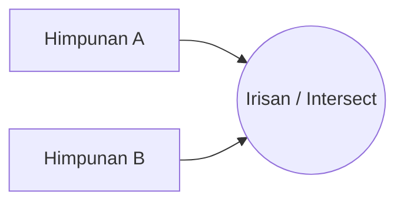

# 🐍 Pemrograman Python Dasar
## Pertemuan 05: Struktur Data (Dictionary & Set)

Pasangan Kunci-Nilai (Key-Value) dan Koleksi Elemen Unik Tanpa Duplikat

<div class="pt-12">
  <span class="px-3 py-1.5 rounded-full bg-amber-500/20 text-amber-300 text-sm border border-amber-500/40">
    Pertemuan 05 • Key-Value Mapping & Sets
  </span>
</div>

---
layout: default
---

# 🎯 Agenda Pertemuan 05

- **1. Konsep Key-Value Mapping**: Mengapa kita butuh Dictionary?
- **2. Karakteristik Dictionary**: Pasangan `key: value`, pencarian cepat $O(1)$, mutable
- **3. Metode Esensial Dictionary**: `get()`, `keys()`, `values()`, `items()`, `update()`
- **4. Nested Dictionary**: Struktur data hierarkis mirip JSON / database record
- **5. Konsep Set (Himpunan)**: Elemen unik, tidak berurutan (*unordered*), menghilangkan duplikasi
- **6. Operasi Matematika Set**: Union ($\cup$), Intersection ($\cap$), Difference ($-$)
- **7. Praktikum**: Kamus istilah pemrograman & pemfilter data kontak duplikat

---
layout: two-cols
---

# 📖 Anatomi Dictionary di Python

::left::
Dictionary ditulis dengan kurung kurawal `{key: value}`:

```python
kontak = {
    "nama": "Andi Pratama",
    "email": "andi@example.com",
    "telepon": "081234567890",
    "aktif": True
}

# Mengakses data dengan key
print(kontak["nama"])   # Andi Pratama

# Menambah / mengubah key
kontak["kota"] = "Bandung"
kontak["aktif"] = False
```

::right::
### Mencegah `KeyError` dengan `.get()`
Jika mengakses key yang tidak ada memakai `[]`, Python melempar error:

```python
# ❌ KeyError jika key tidak ada:
# print(kontak["alamat"])

# ✅ Aman dengan .get(key, default):
alamat = kontak.get("alamat", "Belum diisi")
print(alamat) # Belum diisi
```

---
layout: default
---

# 🔍 Iterasi pada Dictionary: `keys()`, `values()`, `items()`

Gunakan metode `.items()` untuk mendapatkan pasangan key dan valuenya secara bersamaan:

```python
stok_toko = {
    "Laptop": 15,
    "Mouse": 50,
    "Keyboard": 30,
    "Monitor": 12
}

print("=== DAFTAR INVENTARIS GUDANG ===")
for barang, jumlah in stok_toko.items():
    status = "⚠️ Menipis" if jumlah < 15 else "✅ Aman"
    print(f"- {barang:10s} : {jumlah:2d} unit [{status}]")
```

<div class="mt-4 p-3 rounded bg-blue-500/10 border border-blue-500/30 text-sm">
📌 <b>Catatan</b>: <code>stok_toko.keys()</code> menghasilkan daftar semua kunci, sedangkan <code>stok_toko.values()</code> menghasilkan daftar semua nilai.
</div>

---
layout: two-cols
---

# ⭕ Konsep Set (Himpunan Unik)

::left::
Set adalah kumpulan elemen **unik** (tidak ada duplikasi) dan tidak memiliki index.

```python
# Duplikat otomatis dibuang
angka_duplikat = [1, 2, 2, 3, 4, 4, 4, 5]
angka_unik = set(angka_duplikat)
print(angka_unik) # {1, 2, 3, 4, 5}

# Menambah & menghapus
angka_unik.add(6)
angka_unik.remove(2)
```

Sangat berguna untuk menyaring data ganda!

::right::
### Cepat Memeriksa Keanggotaan (`in`)
```python
role_admin = {"superadmin", "manager", "lead"}

user_role = "manager"
if user_role in role_admin:
    print("Akses menu admin diizinkan!")
```

Pencarian elemen pada Set bekerja dengan algoritma Hash Table sehingga sangat instan!

---
layout: default
---

# 🧮 Operasi Matematika Himpunan (Set)



```python
tim_backend = {"Python", "Go", "Docker", "PostgreSQL"}
tim_frontend = {"JavaScript", "TypeScript", "React", "Docker"}

# 1. Union (|): Gabungan semua keahlian
semua_skill = tim_backend | tim_frontend
# {'Python', 'Go', 'Docker', 'PostgreSQL', 'JavaScript', 'TypeScript', 'React'}

# 2. Intersection (&): Keahlian yang sama-sama dimiliki kedua tim
skill_bersama = tim_backend & tim_frontend
# {'Docker'}

# 3. Difference (-): Keahlian yang hanya dimiliki backend tapi bukan frontend
hanya_backend = tim_backend - tim_frontend
# {'Python', 'Go', 'PostgreSQL'}
```

---
layout: default
---

# 🚀 Praktikum Pertemuan 05

Buka folder `pertemuan-05-struktur-data-dict-set/`:

1. **Eksplorasi Kode Contoh**:
   - `01_dasar_dictionary_key_value.py`
   - `02_metode_dictionary.py`
   - `03_dasar_set_himpunan.py`
   - `04_operasi_matematika_set.py`
2. **Soal Latihan**:
   - Penghitung Frekuensi Kata dalam sebuah paragraf kalimat
   - Kamus Istilah Glosarium Komputer
   - Analisis minat hobi bersama antar dua kelompok siswa
3. Semua template dan kunci jawaban tersedia lengkap di folder `latihan/`.
